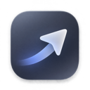

<div align="center">

#  Reach for Mac

— by [razvan136](https://github.com/razvan136)

</div>

Move the macOS pointer with your hand and your camera. Reach lives in the menu
bar and lets you aim, click, drag, scroll, and open Mission Control. The pointer
ring shows the gesture Reach sees. Camera frames are processed on your Mac.

## What you need

- A Mac running **macOS 14 Sonoma or later**, with a built-in or compatible external camera.
- Apple’s **Command Line Tools for Xcode** or a full Xcode installation. The tools include Git and the Swift compiler.

If you need the Command Line Tools, run this in Terminal and finish the macOS
installer before continuing. [Apple’s installation guide](https://developer.apple.com/documentation/xcode/installing-the-command-line-tools)

```sh
xcode-select --install
```

## Build and install

Open Terminal and run these commands. The build uses Apple’s system frameworks
and can sign the app locally without a developer certificate.

```sh
git clone https://github.com/razvan136/reach-for-mac.git
cd reach-for-mac
./build.sh --install
open /Applications/Reach.app
```

If your account cannot write to `/Applications`, run `./build.sh` and open
`build/Reach.app` from the checkout instead.

## First launch

1. Open **Setup & Calibration** from Reach’s menu bar icon.
2. Choose **Allow Camera** and approve the macOS prompt. Choose **Allow Accessibility**, then enable Reach under **System Settings → Privacy & Security → Accessibility**. Camera access tracks your hand. Accessibility lets Reach move the system pointer, click, drag, scroll, and open Mission Control.
3. Select **Calibrate reach (7s)** and move your index fingertip around the area you can comfortably reach. The live preview shows your aiming point and the control area. Reach maps that area to the main display.
4. Select **Start Controls**. Use **Pause Controls** or **Resume Controls** from the menu bar as needed.

If you use a different camera, choose it under **Settings → Camera** before
calibrating. Reach saves calibration separately for each camera and aiming mode.

## Gestures

| Gesture | Action |
| --- | --- |
| Point with your index finger or open your hand | Move the pointer. Hold still briefly to steady it. |
| Touch your thumb to your index finger and release quickly | Click where the pointer was when your fingers touched. |
| Hold your thumb and index finger together | Move your hand while holding a firm pinch to start a drag sooner. A steady hold starts a drag after about a third of a second. Open your fingers to drop. |
| Hold up a peace sign and move it up or down | Scroll while your hand is offset from its starting height. Return to that height or open your hand to stop. |
| Hold up four fingers, fold your thumb across your palm, and swipe downward | Open Mission Control. Choose the window or Space you want. |
| Pinch thumb to index finger on both hands | Spread your pinches to zoom in or bring them together to zoom out. Release a pinch to stop. Aim at a view that supports trackpad pinch-to-zoom. |

Open **Settings** to aim with your palm, adjust cursor, drag, and scroll speeds,
or increase **Smoothing** for a steadier pointer. Select the number beside a
speed slider to type an exact value.

Reach sends mouse and trackpad-style input. macOS 27 lets apps receive direct
touches through AppKit. To generate system-wide touch input from a camera, Reach
would need an Apple-authorized virtual HID device and macOS would need to
recognize it as a touchscreen.

## Troubleshooting

- **The menu says Controls paused.** Open **Setup & Calibration**, confirm both permissions, and select **Start Controls**.
- **The preview is blank.** Check **Privacy & Security → Camera** and select the correct camera in Reach. Use **Retry Camera** from the menu if it appears.
- **The ring moves but the system pointer stays put.** Check the Accessibility entry for the copy of Reach you are running. macOS may ask you to grant access again after a change to the app’s signing identity or installation path.
- **It is hard to reach part of the screen.** Recalibrate with your usual hand position and camera. The outline in the preview marks the mapped area.

## Development

Run the build and self-tests from a logged-in macOS session. The tests use
synthetic hand samples and collect generated input events without posting them.

```sh
./build.sh
./build/Reach.app/Contents/MacOS/Reach --selftest
```

`./build.sh --universal` builds one app bundle with Apple silicon and Intel
slices. The source is in [`Sources/AirWave/`](Sources/AirWave), organized into
hand tracking, pointer and gesture controls, and the native AppKit interface.

The app icon is editable in [`Resources/AppIcon.icon`](Resources/AppIcon.icon).
The build uses the included compiled icon catalog, so you can build Reach
with the Command Line Tools alone.
